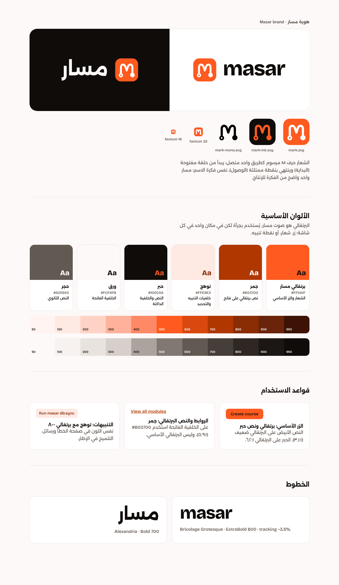

<p align="center">
  <picture>
    <source media="(prefers-color-scheme: dark)" srcset="brand/logo-on-dark.svg">
    
  </picture>
</p>

<h3 align="center">One clear path from idea to production.</h3>

<p align="center">
  The full-stack TypeScript framework where a feature is one folder:<br>
  schema, business logic, pages, API, jobs, mail and admin, wired by convention.
</p>

<p align="center">
  <a href="https://masar.zeyad.io">Website</a> ·
  <a href="https://masar.zeyad.io/docs">Docs</a> ·
  <a href="#quick-start">Quick start</a> ·
  <a href="#benchmarks">Benchmarks</a> ·
  <a href="#license">License</a>
</p>

<p align="center">
  <a href="https://www.npmjs.com/package/masar"></a>
  <a href="https://www.npmjs.com/package/create-masar"></a>
  
  
  
  
</p>

---

## What is Masar?

**Masar** (مسار, Arabic for *path*) is a full-stack TypeScript framework for building real products:
web apps, back offices and APIs for mobile apps, from one codebase.

You describe a feature once, in one folder, and Masar turns it into everything around it:

```
src/modules/courses/
├── module.ts        name, URL prefix, database, ui/api, who can access it
├── schema.ts        models → tables or collections (created and migrated for you)
├── actions.ts       business logic, validated with zod, typed end to end
├── routes.ts        extra HTTP endpoints (webhooks, downloads)
├── jobs/            background work, retried on failure
├── schedule.ts      recurring tasks
├── seeds.ts         sample data
├── mail/            mail templates in React
└── views/pages/     one file = one URL, server-rendered for SEO
```

That one folder gives you: database tables, validated server functions, typed browser calls,
a JSON API for mobile, React pages with SSR, an admin screen, translations, background jobs and seed data.

## Why we built it

Building a product in JavaScript today means assembling a framework yourself: a router, an ORM,
an auth library, a validation library, a queue (and Redis), a mailer, an admin panel, an i18n library,
upload handling, a job scheduler. Each one has its own conventions and its own docs, and the glue
between them is the code you maintain forever.

Laravel and Rails solved this years ago with one framework that has an answer for everything.
The JavaScript world has excellent pieces but no single path. Masar is that path:

- **One way to do each thing.** No five ways to fetch data. A page reads with `load()`; it writes with an action.
- **Batteries included, no infrastructure tax.** The queue, scheduler, sessions, mail outbox and locks run on
  the database you already have. No Redis to start.
- **Built for Arabic and English from day one.** Right-to-left layout switches automatically, mail included.
- **Built for teams and AI agents.** Every new app ships `AGENTS.md` and `CLAUDE.md` that teach coding agents
  the whole framework, so Claude Code, Codex and Cursor write correct Masar code from the first prompt.
- **Errors that tell you what to do.** Every error a developer can hit comes with a hint and a next step.

## The idea in one example

```ts
// schema.ts
export const courses = model('courses', {
  title: f.string(),
  price: f.number().default(0),
  teacherId: f.ref('users'),
  cover: f.file({ accept: ['image/*'], maxSize: '2mb' }).optional(),
})

// actions.ts
export const createCourse = action({
  authorize: 'user',
  input: z.object({ title: z.string().min(2), price: z.number().min(0) }),
  run: ({ input }) => db(courses).create({ ...input, teacherId: auth.user()!.id }),
})
```

```tsx
// views/pages/index.tsx → GET /courses (server-rendered)
export async function load() {
  return { courses: await db(courses).with({ teacher: users }).latest().all() } // server only
}

export const meta = { title: 'Courses', description: 'Learn something new' }

export default function Courses({ courses }: PageProps<typeof load>) {
  const create = useAction(createCourse, { reload: true }) // typed RPC, no fetch, no API layer
  return <CourseList courses={courses} onCreate={create.run} />
}
```

- **The same action** runs on the server, from the browser (Masar turns the import into a typed RPC call),
  and as JSON at `POST /api/courses/create-course` for mobile apps.
- **`load()` never reaches the browser.** Masar strips it, so a page can call the database directly.
- **Types flow from the schema** to actions and page props. No codegen step.

## Features

| | |
| --- | --- |
| **Modules** | Discovered from the file system. No registration files, no routing table to keep in sync. |
| **Data layer** | One API for SQLite, PostgreSQL and MongoDB. Relations with `with()`, transactions, pagination. Each module can use a different database. |
| **Schema sync + migrations** | New tables, columns and indexes are created as you save. Renames and drops are versioned migrations, never automatic. |
| **Actions** | Server functions with zod validation and required authorization. Called directly, from React, or as a REST API. |
| **Pages** | React 19 + Inertia. Server-rendered for search engines, then hydrated. `meta`, `sitemap.xml` and `robots.txt` generated. |
| **Auth** | Sessions, roles, API tokens, email confirmation and password reset, built in. Every action is locked until you say otherwise. |
| **Jobs + scheduler** | A queue on your own database with retries, delays and multiple workers, plus cron-style schedules that run once per slot across servers. |
| **Mail** | React mail templates in the brand, SMTP, Resend or Postmark, a dev outbox at `/_masar/mail`, sent through the queue. |
| **Uploads** | Local disks or any S3-compatible service, direct-to-bucket uploads, signed references, files deleted with their records. |
| **Admin panel** | Generated from your models, like Filament: tables, filters, search, forms, CSV export, dashboard widgets, custom pages. |
| **i18n + RTL** | Locale per visitor, translation files filled in automatically, right-to-left for Arabic, light/dark theme. |
| **Security** | Secure headers, rate limiting, CSRF protection for actions, CORS only where you enable it. |
| **Seeds** | A seeded fake-data generator (Arabic and English names) and `masar db:seed --fresh`. |
| **Dev experience** | Vite 8 with hot reload, a branded error overlay with next steps, `masar routes` to see everything. |
| **Installer** | `npm create masar` opens a setup page in your browser (Arabic or English): database, languages, mail, storage, admin. Every step can be skipped. |
| **AI ready** | `AGENTS.md` + `CLAUDE.md` in every app, docs over MCP at [masar.zeyad.io/docs](https://masar.zeyad.io/docs). |

## Quick start

Requires **Node.js 22.13+**.

```bash
npm create masar@latest my-app
```

A setup page opens in your browser. Pick your database, languages, mail and storage, or press
**Use defaults and create**. Then:

```bash
cd my-app
npm run dev          # http://localhost:3000
npx masar make:module courses   # model + CRUD actions + pages + form, ready to run
```

Prefer the terminal? `npm create masar@latest my-app -- --cli`.

## A different unit of progress: the feature

Masar's bet is simple: **a feature should be the unit you build, review and ship**.
A course, invoice or booking belongs in one module, together with its data, actions, pages and background work.
The framework connects those parts, so adding the next feature follows the same path as the first.

The shift is from assembling infrastructure for every app to declaring the product you want to build:

1. **Describe the data.** Models define fields, validation metadata and the shape the admin can use.
2. **Write the operation once.** An action validates input and checks authorization before business logic runs.
3. **Expose it deliberately.** React calls the action through typed RPC; `expose: { api: true }` also makes
   the module's actions available as JSON endpoints for other clients.
4. **Keep the workflow together.** Pages, jobs, schedules, mail and seeds live alongside the feature.

### Why Masar has its own architecture

Masar applications run on **Hono + Vite + React + Inertia**. They do not depend on Next.js.
Masar owns module discovery, its action protocol, database access, authentication and the application lifecycle.
React provides the UI; Inertia handles page navigation; Vite compiles client and server builds.

| Design choice | What it means in a Masar app |
| --- | --- |
| Feature folders | Business logic and UI for one capability stay under `src/modules/<feature>/`. |
| Server page loaders | `load()` reads on the server; its result becomes the React page's props. |
| Actions with authorization | Writes go through validated server operations with an explicit access rule. |
| One data API | Modules choose SQLite, PostgreSQL or MongoDB through named connections. |
| Database-backed services | Jobs, schedules and sessions can share the application's database. |
| Arabic and English starter | Translation files, locale switching and RTL are part of the starting app. |

This is an opinionated choice for products that need a UI, API and back office together.
Choose it for that workflow, and evaluate the **0.1** release against your application's requirements.
The promise is less integration work and a predictable place for each feature, rather than a universal performance claim.

## Application structure

`npm create masar@latest my-app` creates a standalone application:

```text
my-app/
├── package.json              scripts and published Masar dependencies
├── tsconfig.json             strict TypeScript and the @/ alias
├── components.json           shadcn/ui configuration
├── .env                      local secrets; never commit this file
├── .env.example              configuration reference without secrets
├── .gitignore
├── AGENTS.md                 framework instructions for coding agents
├── CLAUDE.md                 additional agent entry point
├── public/                   static files and favicon
└── src/
    ├── config/
    │   ├── app.ts            app URL, port, locales and security
    │   ├── database.ts       named database connections
    │   ├── mail.ts           mail transport
    │   └── storage.ts        local and S3-compatible disks
    ├── locales/              en.json, ar.json
    ├── shared/
    │   ├── ui/               editable shadcn/ui components
    │   ├── components/       navigation, language and theme controls
    │   ├── layouts/          shared React layouts
    │   ├── styles/           application CSS
    │   └── lib/              shared helpers
    └── modules/
        ├── home/             starter landing page
        ├── auth/             login, registration and email flows
        ├── admin/            dashboard and user resource
        └── courses/          example feature: generated with make:module
            ├── module.ts     URL prefix, exposure and authorization
            ├── schema.ts     models
            ├── actions.ts    validated server operations
            └── views/
                ├── pages/    index.tsx, [id].tsx and other page files
                └── components/
```

The `courses/` folder is an example, added with `npx masar make:module courses`.
Optional module files include `routes.ts`, `schedule.ts`, `seeds.ts`, `jobs/`, `mail/` and migrations.
Masar creates `.masar/` for generated entries, `database/` for the default SQLite database,
`storage/` for local uploads and `dist/` when you build. These are generated or runtime data, not feature source.

## npm packages

| Package | Purpose |
| --- | --- |
| [`create-masar`](https://www.npmjs.com/package/create-masar) | The installer behind `npm create masar@latest`. |
| [`masar`](https://www.npmjs.com/package/masar) | Runtime, server and React APIs. |
| [`masar-cli`](https://www.npmjs.com/package/masar-cli) | The `masar` development, build, database and generator commands. |

The installer adds compatible versions for you. Framework maintainers can follow
[RELEASING.md](RELEASING.md) to validate and publish an update.

## Benchmarks

Measured on the production build of the [playground](playground) (`masar build && masar start`),
**SQLite**, rate limiting off, one Node process, with [autocannon](https://github.com/mcollina/autocannon)
(50 connections, 10 seconds). Machine: Intel Core i7-8850H (2018 laptop), Node 26.

| Endpoint | What it does | Requests/s | p50 | p99 |
| --- | --- | ---: | ---: | ---: |
| `GET /` | Full page with **server-side React rendering** | **1,778** | 26 ms | 54 ms |
| `GET /api/courses/list-courses` | Bearer auth + session lookup + zod + paginated DB query | **1,862** | 25 ms | 51 ms |
| `GET /sitemap.xml` | Database query + XML | **2,250** | 21 ms | 45 ms |
| `GET /robots.txt` | Router + security middleware | **8,536** | 5 ms | 11 ms |

| | |
| --- | --- |
| Production build time | **1.8 s** |
| Server boot to first response | **≈ 2.4 s** (including `npx`) |
| Home page JS + CSS, gzipped | **130 KB** (React 19, Inertia, the app) |
| Zero errors, zero non-2xx responses | ✅ in every run |

These are real numbers from one run on old hardware, not a lab. A modern machine is faster, and you
can run more processes behind a load balancer: sessions, the queue and schedules already work across
servers. Reproduce them:

```bash
pnpm install && pnpm build
cd playground && PORT=3100 APP_KEY=bench NODE_ENV=production npx masar start --no-worker
npx autocannon -c 50 -d 10 http://localhost:3100/
```

## Commands

| Command | What it does |
| --- | --- |
| `masar dev` | Dev server with hot reload, schema sync, jobs and schedules |
| `masar build` / `masar start` | Production build / server (`--no-worker` to run jobs elsewhere) |
| `masar worker` | Extra job worker process |
| `masar make:module <name>` | Module with model, CRUD actions, pages and form (`--api`, `--no-ui`, `--no-crud`) |
| `masar make:migration <module> <name>` | Versioned migration |
| `masar make:admin-page "<Title>"` | Custom admin page |
| `masar migrate` / `migrate:status` | Run migrations, then sync |
| `masar db:sync` | Create missing tables, columns, indexes |
| `masar db:seed [--fresh]` | Sample data |
| `masar routes` | Every page, action, API and route |
| `masar i18n` | Add missing translation keys |
| `masar user:role <email> <role>` | Change a user's role |

## Repository

| Path | What it is |
| --- | --- |
| [`packages/core`](packages/core) | `masar`: kernel, modules, actions, pages, data layer, auth, jobs, mail, storage, admin, i18n |
| [`packages/cli`](packages/cli) | `masar-cli`: the `masar` command and the Vite setup |
| [`packages/create-masar`](packages/create-masar) | `npm create masar`: the browser installer and the starter app |
| [`playground`](playground) | A Masar app used to develop and test the framework |
| [`brand`](brand) | Logo, palette and brand sheet |

Built on [Vite](https://vite.dev), [Hono](https://hono.dev), [Inertia.js](https://inertiajs.com) with
React 19, [Tailwind CSS](https://tailwindcss.com) v4 + [shadcn/ui](https://ui.shadcn.com) and [zod](https://zod.dev).

### Develop the framework

```bash
pnpm install
pnpm dev          # playground on http://localhost:3000
pnpm typecheck
pnpm e2e          # browser + HTTP tests against the running playground
```

## Status

Version 0.1. Verified end to end: dev and production builds, SSR, actions (RPC and API), auth with
email flows, SQLite and PostgreSQL with identical results, multiple databases in one app, the database
queue across processes, schedules, uploads to local disks and S3 (MinIO), the admin panel.
The MongoDB adapter has had less testing so far.

Release checks include TypeScript validation, a production build and an isolated install of the packed npm artifacts.
See [RELEASING.md](RELEASING.md) for the release process. The adapters and integrations still need broader automated coverage.

<p align="center"></p>

## License

Masar is **source-available** under the [Functional Source License, Version 1.1, ALv2 Future License](LICENSE)
(`FSL-1.1-ALv2`).

- ✅ **Build anything with it**: your products, client projects, commercial SaaS, internal tools. Free.
- ✅ Read, modify and learn from the code. Contributions are welcome.
- ❌ **Do not take Masar's source to make a competing product**: another framework, a fork sold as a
  substitute, or a service that offers Masar itself.
- 🔓 Each release becomes **Apache 2.0** two years after it is published.

The code that `npm create masar` generates into your app is yours, under your own license.

---

<p align="center">
  Designed and built by <a href="https://zeyadshalaby.com"><b>Zeyad Shalaby</b></a> ·
  <a href="https://masar.zeyad.io">masar.zeyad.io</a>
</p>
